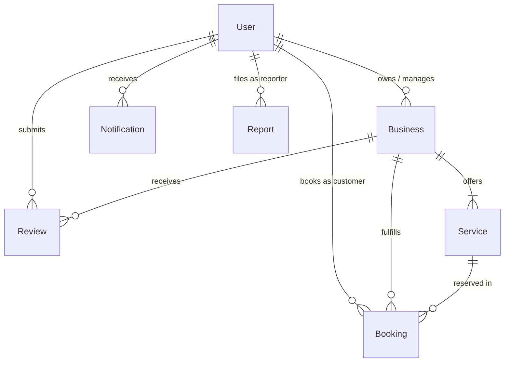

# AUroRA Database Architecture & Schema Specification

This document details the MongoDB data models, schemas, relationships, indexing strategies, and validation rules for the AUroRA platform.

---

## 1. Entity Relationship Diagram



---

## 2. Collections & Schema Definitions

### 2.1 `users` Collection
Manages authentication credentials and role-based permissions (`customer`, `provider`, `admin`).

| Field | Type | Required | Constraints / Index | Description |
|---|---|---|---|---|
| `_id` | ObjectId | Yes | Primary Key | Unique user identifier |
| `name` | String | Yes | `minlength: 2`, `maxlength: 100` | Full legal or display name |
| `email` | String | Yes | **Unique Index**, Lowercase, Regex validation | Authentication identifier |
| `password` | String | Yes | Bcrypt hash, `minlength: 6`, `select: false` | Salted password hash |
| `role` | String | Yes | Enum: `['customer', 'provider', 'admin']`, **Index** | Authorization role |
| `phone` | String | No | Trimmed | Contact mobile number |
| `address` | String | No | Trimmed | Residential/billing address |
| `avatar` | String | No | URL | Profile image CDN link |
| `status` | String | Yes | Enum: `['active', 'suspended']`, **Index** | Account status |
| `businessId` | ObjectId | No | Ref: `Business` | Associated business (for providers) |
| `createdAt` | Date | Auto | ISO Timestamp | Registration date |
| `updatedAt` | Date | Auto | ISO Timestamp | Last modification date |

---

### 2.2 `businesses` Collection
Stores registered local service businesses, geo coordinates, categories, operating hours, and verified status.

| Field | Type | Required | Constraints / Index | Description |
|---|---|---|---|---|
| `_id` | ObjectId | Yes | Primary Key | Unique business identifier |
| `ownerId` | ObjectId | Yes | Ref: `User`, **Index** | Provider account that owns the business |
| `name` | String | Yes | `minlength: 2`, `maxlength: 120`, **Text Index** | Trade name of the establishment |
| `tagline` | String | No | Max 160 chars | Luxury one-line positioning statement |
| `category` | String | Yes | Enum (6 Categories), **Index** | Discovery categorization |
| `city` | String | Yes | Enum: Bengaluru, Mumbai, Delhi NCR, Hyderabad, Pune, **Index** | Geographic metro region |
| `address` | String | Yes | String | Full physical street address |
| `phone` | String | Yes | String | Official booking / contact phone |
| `email` | String | Yes | Lowercase | Direct customer liaison email |
| `rating` | Number | No | Range: 0.0 - 5.0, Default: 5.0 | Aggregate average rating |
| `reviewCount` | Number | No | Default: 0 | Number of verified customer reviews |
| `image` | String | Yes | Image URL | High-resolution hero image |
| `gallery` | [String] | No | Array of URLs | Additional facility photographs |
| `description` | String | Yes | Detailed description | Full editorial overview |
| `operatingHours`| Object | No | Key-value pairs per weekday | Daily opening and closing schedules |
| `status` | String | Yes | Enum: `['pending', 'verified', 'suspended']`, **Index** | Verification status |

---

### 2.3 `services` Collection
Individual service offerings associated with a specific business.

| Field | Type | Required | Constraints / Index | Description |
|---|---|---|---|---|
| `_id` | ObjectId | Yes | Primary Key | Unique service identifier |
| `businessId` | ObjectId | Yes | Ref: `Business`, **Index** | Foreign key linking to parent business |
| `name` | String | Yes | Trimmed | Name of the treatment or service |
| `category` | String | Yes | **Index** | Category alignment |
| `description` | String | Yes | String | Detailed breakdown of procedure |
| `durationMinutes`| Number | Yes | Positive integer (e.g. 45, 60, 90) | Service session length |
| `price` | Number | Yes | Minimum: 0 (in INR `₹`) | Base fee |
| `isPopular` | Boolean | No | Default: false | Featured badge indicator |
| `availableDays` | [String] | No | Array of weekdays | Operational availability days |
| `isActive` | Boolean | Yes | Default: true, **Index** | Toggle for availability |

---

### 2.4 `bookings` Collection
Reservations lifecycle management between customers and businesses.

| Field | Type | Required | Constraints / Index | Description |
|---|---|---|---|---|
| `_id` | ObjectId | Yes | Primary Key | Unique booking reservation code |
| `bookingCode` | String | Yes | **Unique Index** (e.g. `AUR-78294`) | Human-readable receipt code |
| `customerId` | ObjectId | Yes | Ref: `User`, **Index** | Customer user reference |
| `customerName` | String | Yes | String | Customer name snapshot |
| `customerEmail`| String | Yes | String | Customer email snapshot |
| `customerPhone`| String | No | String | Customer phone snapshot |
| `businessId` | ObjectId | Yes | Ref: `Business`, **Index** | Business establishment reference |
| `businessName` | String | Yes | String | Business name snapshot |
| `serviceId` | ObjectId | Yes | Ref: `Service` | Reserved service reference |
| `serviceName` | String | Yes | String | Service name snapshot |
| `price` | Number | Yes | INR `₹` | Total price at booking time |
| `date` | String | Yes | Format: `YYYY-MM-DD`, **Index** | Scheduled service date |
| `timeSlot` | String | Yes | Format: `HH:MM AM/PM` | Scheduled service time slot |
| `status` | String | Yes | Enum: `['pending', 'confirmed', 'completed', 'cancelled']`, **Index** | Workflow status |
| `specialRequests`| String | No | String | Client notes / preferences |

---

## 3. Database Management & Commands

### Running Seed Script
```bash
# From within the database directory:
npm run seed

# Or directly with node:
node seeds/seed.js
```

### Connection String Configuration
- Default Local URI: `mongodb://127.0.0.1:27017/aurora`
- Environment override: Set `MONGODB_URI` in `.env`.
